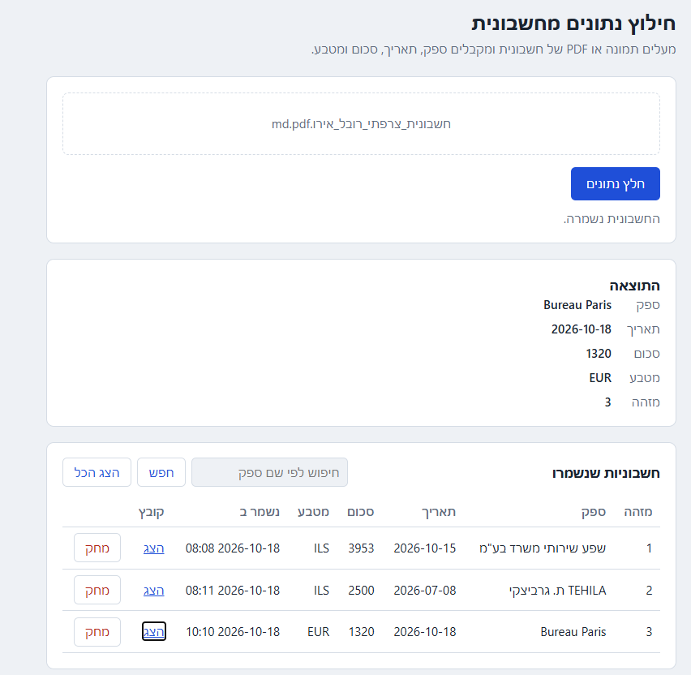
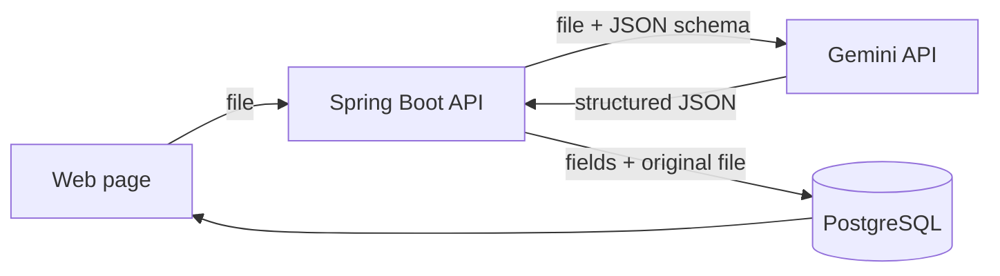

# doc-extractor

**Turn an invoice into structured data in seconds.**
Upload a photo or PDF of an invoice. Gemini reads it, and the vendor, date, total and currency land in PostgreSQL, ready to search.



Built to handle real-world Hebrew invoices: right-to-left text, `DD/MM/YYYY` dates, and the ₪ sign.

## What it returns

Input: a photo or PDF of an invoice. Output:

```json
{
  "id": 2,
  "vendor": "TEHILA ת. גרביצקי",
  "invoiceDate": "2026-07-08",
  "total": 2500.00,
  "currency": "ILS"
}
```

## How it works



## Design decisions

- **Structured output instead of free text.** The request includes a JSON response schema and `temperature: 0`, so the model must return exactly four fields in a predictable shape.
- **Missing is better than wrong.** Every field is nullable, and the prompt tells the model to return `null` rather than guess. A blank field is easy to spot; a wrong total is not.
- **Forgiving parser.** If the model returns an array instead of an object, the first item is used. A date or amount that cannot be parsed is logged and left empty rather than failing the whole upload.
- **Original file kept.** The image or PDF is stored as `bytea` next to the extracted fields, so any result can be checked against its source.

## Quick start

You need JDK 21, Docker Desktop and a free [Gemini API key](https://aistudio.google.com/).

```bash
# 1. start PostgreSQL (localhost:5433)
docker compose up -d

# 2. set your key (PowerShell: setx GEMINI_API_KEY "your-key", then restart the terminal)
export GEMINI_API_KEY=your-key

# 3. run
./mvnw spring-boot:run
```

Open <http://localhost:8081>.

> **Windows tip:** if you see `PKIX path building failed`, add the JVM argument `-Djavax.net.ssl.trustStoreType=WINDOWS-ROOT`.

## API

| Method | Path | What it does |
|---|---|---|
| `POST` | `/api/documents/extract` | Upload a file (`multipart/form-data`, field `file`), extract and save |
| `GET` | `/api/documents` | List all invoices |
| `GET` | `/api/documents/search?vendor=...` | Search by vendor (case-insensitive) |
| `GET` | `/api/documents/{id}` | Get one invoice |
| `GET` | `/api/documents/{id}/image` | View the original file |
| `DELETE` | `/api/documents/{id}` | Delete an invoice |

```bash
curl -F "file=@invoice.pdf" http://localhost:8081/api/documents/extract
```

## Configuration

| Setting | Default | Notes |
|---|---|---|
| `GEMINI_API_KEY` | none | Required, read from the environment |
| `DB_PASSWORD` | `postgres` | Local development default |
| `gemini.model` | `gemini-3.5-flash-lite` | Any Gemini model that supports structured output |
| `spring.servlet.multipart.max-file-size` | `10MB` | Upload limit |

## Tech stack

Java 21 · Spring Boot 4 · Spring Data JPA · PostgreSQL 16 · Docker Compose · Google Gemini API · plain HTML/JS front end

## Limitations and next steps

- Accuracy depends on scan quality, so results should be reviewed before being used for accounting
- Schema is created by Hibernate (`ddl-auto=update`), fine for development; Flyway is the next step
- No authentication
- Planned: parser unit tests, a "needs review" status for incomplete results, a Dockerfile for the app

## Author

Rivka Glass · [github.com/RivkaGlass](https://github.com/RivkaGlass)
